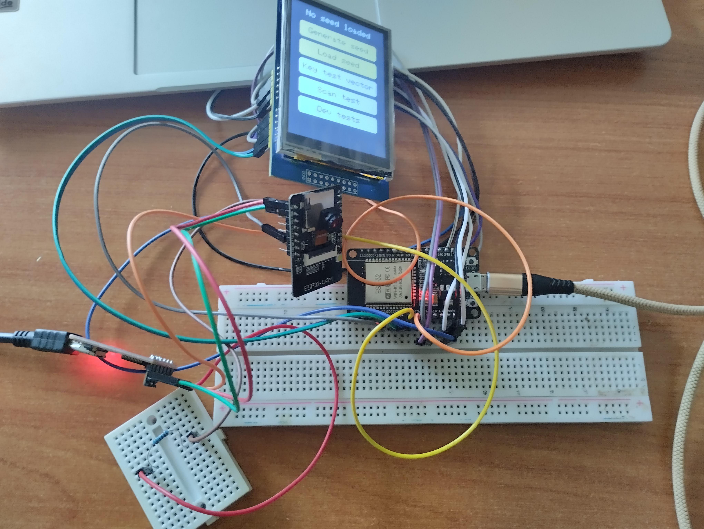

# BitForge



BitForge is an air-gapped Bitcoin signing device you can build from common hobby boards. You need an ESP32 DevKit, an ESP32-CAM and a 2.8" touchscreen shield. It works with [Sparrow Wallet](https://sparrowwallet.com) on your computer, and the two only ever exchange data through QR codes. There is no USB data, Wi-Fi or Bluetooth link between them.

> ⚠ **This is a prototype for signet, Bitcoin's test network. Never use it with real funds or a real seed.**
> It has no secure element and no secure boot. The ESP32 also has a radio, which the firmware doesn't use but which is still there. The firmware is hard-coded to signet.

## How it works

1. Sparrow holds only your public keys, which makes it a "watch-only" wallet. It builds an unsigned transaction, called a PSBT, and shows it as an animated QR code.
2. The ESP32-CAM scans the QR and sends the data to the wallet over one wire, in one direction. The wallet has no way to send data back to the camera.
3. The wallet works out the amounts, the fee and your change by itself, using only the transaction data and your keys. It shows them on the touchscreen.
4. You approve or reject on the touchscreen. If you approve, the wallet signs and shows the signed transaction as an animated QR code.
5. Sparrow scans it with your webcam and broadcasts it.

The seed is never stored. You load it each time you start the device, either by typing the words or by scanning a SeedQR. It's wiped from memory when you choose **Wipe & lock** or when the device sits idle for 5 minutes.

## What's in this repo

```
airgap_wallet/        Firmware for the ESP32 DevKit (the signer)
  airgap_wallet.ino     main menu and screens
  config.h              pins and settings (must match docs/wiring.md)
  display.*, touch.*, calibrate.*, ui.*    screen, touch input, buttons and keyboard
  entropy.*, seedgen.*, seedload.*, seedqr.*, keys.*, session.*, lock.*, secure_mem.*
                        creating, loading, holding and wiping the seed
  descriptor.*, export_screen.*, address_screen.*
                        watch-only export to Sparrow, address check
  camlink.*, scan_screen.*                 receiving QR data from the camera
  psbt_scan.*, psbt_parse.*, psbt_review.*, psbt_review_screen.*, psbt_sign.*, psbt_flow.*
                        the signing pipeline: scan, parse, verify, review, sign
  qr_out.*              showing QR codes (static and animated)
  ur_selftest.*, psbt_selftest.*           on-device self-tests (+ generated *_vectors.h)
  src/ur/               UR (animated QR) encoder/decoder, ported from bc-ur
  src/qrgen/            QR code generator (vendored, see docs/patches.md §3)
  partitions.csv        flash layout (no core-dump partition, so no RAM is written to flash)

airgap_qrcam/         Firmware for the ESP32-CAM (the QR scanner)
  airgap_qrcam.ino      camera, QR decoding, debug console
  link_frame.*          the frame format sent to the wallet
  src/quirc/            QR decoder (vendored, see docs/patches.md §6)

docs/
  wiring.md             how to connect everything
  patches.md            library changes you need to apply
  protocol.md           camera link format, Sparrow QR formats, SeedQR

tools/                PC-side helpers (Node.js)
  cam_viewer/           live camera preview, link checker, serial logger, scan statistics
  link_fuzz/            turns the CAM into a fuzzer for the camera link
  pc_checks/            independent checks of fingerprints, addresses, descriptors
  psbt_fixtures/        builds the 82 test PSBTs for the on-device PSBT self-test
  psbt_show/            shows a saved PSBT file as an animated QR in your browser
  ur/                   UR decoder in JS, its tests, and the UR self-test generator
```

## What you need

| Part | Used for |
|---|---|
| ESP32 DevKit (ESP32-WROOM-32) | the signer |
| ESP32-CAM (AI-Thinker, OV2640) | the QR scanner |
| 2.8" TFT touch shield for Arduino Uno (ILI9341, 8-bit parallel, resistive touch) | screen and input |
| USB-TTL adapter (FT232, CH340 or CP2102) | flashing the ESP32-CAM |
| Jumper wires | connections |
| A computer with Sparrow Wallet and a webcam | building and broadcasting transactions |

To wire everything up, follow [docs/wiring.md](docs/wiring.md).

## Build and flash

### 1. Install the tools

Install the [Arduino IDE](https://www.arduino.cc/en/software). Then open **Tools → Board → Boards Manager**, search for **esp32 by Espressif Systems** and install version **3.3.10**.

### 2. Install the libraries

| Library | Version | How |
|---|---|---|
| MCUFRIEND_kbv | 3.0.0-Release | Library Manager, then apply patches 1, 4 and 5 |
| Adafruit GFX Library | 1.12.6 | Library Manager |
| Adafruit BusIO | 1.17.4 | Library Manager (needed by GFX) |
| Adafruit TouchScreen | 1.1.6 | Library Manager |
| uBitcoin | 0.2.0 + secret wiping | clone the [fork](https://github.com/muchai254/uBitcoin/tree/muchai254/secret_material_wiping) into your libraries folder, then apply patch 2 |

You'll find the patches in [docs/patches.md](docs/patches.md). Without them the firmware won't compile, or the board won't boot reliably.

### 3. Flash the ESP32-CAM

Open `airgap_qrcam/airgap_qrcam.ino` in the Arduino IDE. Under **Tools**, set the board to **AI Thinker ESP32-CAM** and pick the adapter's port.

Connect the USB-TTL adapter as described in wiring.md §C. Then connect GPIO0 to GND, press RESET and click **Upload**. When it's done, remove the GPIO0 wire and press RESET again.

### 4. Flash the DevKit

Open `airgap_wallet/airgap_wallet.ino`. Under **Tools**, set the board to **ESP32 Dev Module** and pick the DevKit's port.

Hold the **BOOT** button down and click **Upload**. Keep holding it for the whole upload. When the upload finishes, release it and press EN.

Each sketch folder has its own `partitions.csv`, and the IDE uses it automatically, so you don't need to change the partition scheme.

The touch calibration values in `config.h` belong to the author's screen, and yours will be different. To calibrate, set `TOUCH_CAL_VALID` to 0 and flash. The wallet then runs calibration at boot. Copy the values it shows into `config.h` and set `TOUCH_CAL_VALID` back to 1.

### 5. Use it with Sparrow (signet)

1. Switch Sparrow to **signet**.
2. Load a seed on the device. For testing, you can use the public test phrase `abandon` ×11 + `about` or generate a new one. **Never use a seed that holds real funds.**
3. On the device, choose **Export to Sparrow**. In Sparrow, go to New Wallet → Airgapped Hardware Wallet, pick a QR wallet entry and scan the QR. It has been tested with "Era Wallet".
4. Get signet coins from a signet faucet.
5. Build a transaction in Sparrow and show it as a QR. **Set QR density to the lowest setting**, because the camera reads small codes much better.
6. On the device, choose **Sign PSBT**, scan the QR, check each review screen and approve.
7. Scan the signed QR back into Sparrow and broadcast it.

When a transaction has more than one input, Sparrow's QR leaves out data the device requires. [protocol.md](docs/protocol.md#input-amounts-and-non_witness_utxo) explains why. For these transactions, save the PSBT to a file in Sparrow and show it with `node tools/psbt_show/show.js <file.psbt>`.

## Tests

The Dev tests menu on the device runs three checks.

- The UR self-test runs the UR decoder against the bc-ur vectors, hostile input and real Sparrow captures.
- The PSBT self-test runs 82 PSBTs, both valid and malicious, and each one must get the expected verdict.
- The key test vector derives the BIP84 test vectors and checks that no secret is left on the stack.

On your computer, the tests need Node.js 18 or later.

```
node tools/ur/test.js                          # UR decoder tests
cd tools/cam_viewer
node tests/link_check_test.js link_check.js     # camera-link frame parser
node tests/viewer_parser_test.js viewer.js     # camera console parser
node tests/reconnect_test.js                   # serial reconnect
cd ../..
node tools/pc_checks/fingerprint.js            # expect 73c5da0a
```

The camera tests use a stand-in for the serial port, so you don't need a board. Before using `tools/psbt_show` or `tools/cam_viewer`, run `npm install` in its folder.

To rebuild the self-test data, run these two generators.

```
node tools/psbt_fixtures/make_fixtures.js   # writes airgap_wallet/psbt_selftest_vectors.h
node tools/ur/gen_selftest.js               # writes airgap_wallet/ur_selftest_vectors.h
```

The UR generator needs Sparrow PSBT captures in `tools/ur/fixtures/`. They aren't included in this repo, but you can capture your own with `tools/cam_viewer/viewer.js --log`.

## Security rules the code follows

- The seed is never stored. Secrets are never written to flash, and the flash layout has no core-dump partition.
- Secrets never appear on serial output.
- Everything from the camera is treated as hostile. Every frame is checked, and PSBTs go through a strict parser written for BitForge.
- The scanned PSBT is never handed to uBitcoin. Instead, the wallet signs a minimal PSBT that it rebuilds from values it has verified itself.
- Secrets are wiped from RAM after use. That covers buffers, the stack and the free heap.
- There is no radio code. Wi-Fi and Bluetooth are never included.
- Everything is signet only, and keys are always derived for signet.

## Licence

Code in this repo is under the [MIT licence](LICENSE). Some parts come from other projects and keep their own licences.

| Code | From | Licence |
|---|---|---|
| `airgap_qrcam/src/quirc/` | [quirc](https://github.com/dlbeer/quirc) | ISC |
| `airgap_wallet/src/qrgen/` | [QRCode](https://github.com/ricmoo/qrcode) | MIT |
| `airgap_wallet/src/ur/`, `tools/ur/ur.js` | ported from [bc-ur](https://github.com/BlockchainCommons/bc-ur) | BSD-2-Clause-Patent |
